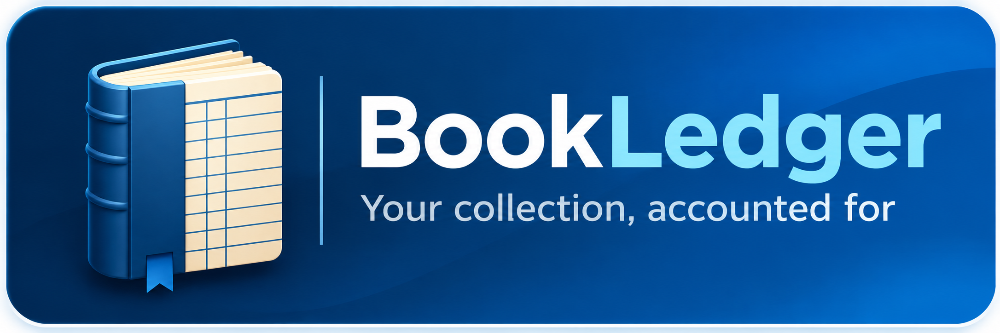

# BookLedger



BookLedger is an offline-first book inventory manager for Windows. Track bibliographic records and individual physical copies in a local SQLite database, with an Android companion for capturing ISBNs and cover photos.

**Platform:** Windows 11 x64 desktop; current source targets desktop 1.1.0 and Android companion 1.1.0+2.

**Unpublished candidate:** v1.1.0-rc1 is being prepared for maintainer acceptance. See the [changelog](CHANGELOG.md), [draft release notes](docs/RELEASE_NOTES_v1.1.0.md), and [candidate checklist](docs/RELEASE_CHECKLIST_v1.1.0.md). The public stable release below remains v1.0.0.

**Release:** [BookLedger v1.0.0](https://github.com/hectordoesgorug/BookLedger/releases/tag/v1.0.0) was published on November 16, 2026. The Windows ZIP, Android APK, and `SHA256SUMS.txt` are available on the release page.

## Desktop features

- Catalog books with optional subtitles and separately track each copy, including photo, condition, location, price, and status.
- Search, filter, and sort the catalog and inventory.
- Look up ISBN metadata from configurable online providers; manual entry remains available.
- Track sales and reversals, review Sale History, and view inventory and sales reports.
- Create copy posters, verify local database and file integrity, and make portable backups.
- Use core cataloging and inventory features offline. Metadata lookups require an internet connection.

## Android companion

The Android app scans ISBN barcodes or accepts manual/no-ISBN entry, captures front-cover photos, and transfers single or queued captures to BookLedger Desktop. Bulk Entry queues 5–20 captures. The desktop remains the library manager and catalogs received books one at a time.

## Install BookLedger Desktop

The preferred Windows distribution is the portable one-file ZIP, [`BookLedger-v1.0.0-Windows-x64-Portable.zip`](https://github.com/hectordoesgorug/BookLedger/releases/download/v1.0.0/BookLedger-v1.0.0-Windows-x64-Portable.zip), available from the [v1.0.0 release page](https://github.com/hectordoesgorug/BookLedger/releases/tag/v1.0.0). Download `SHA256SUMS.txt` from that page to verify the package.

1. Extract the entire ZIP to a folder writable by your Windows account.
2. Run `BookLedger/BookLedger.exe`.
3. Keep the package folders and files beside the executable.

On first launch, BookLedger creates its local configuration and data folders. Do not move or run only the executable by itself.

## Install and pair the Android companion

The published [Android companion APK](https://github.com/hectordoesgorug/BookLedger/releases/download/v1.0.0/BookLedger-v1.0.0-Android.apk) is `BookLedger-v1.0.0-Android.apk` (application ID `com.bookledger.mobile`, version `1.0.0+1`). The unpublished v1.1.0-rc1 companion uses `1.1.0+2` and requires separate acceptance. It is distributed by sideloading, not through Google Play. You can also export the bundled APK from BookLedger Desktop when using a package that contains it. Android may ask you to allow installs from that source.

Open **Settings → Mobile App Setup** on the desktop, then pair the phone by scanning the QR code or entering the desktop's local IPv4 address. The devices need to reach each other on the same local network. See the [mobile guide](mobile/README.md) for pairing, transfer, and recovery instructions.

## Network and privacy

BookLedger does not synchronize your library to a cloud service. Desktop pairing and capture transfer use token-authenticated, **unencrypted HTTP** on your local network. Pair only on a trusted network; allow BookLedger through the Windows firewall on a trusted/private network if Windows asks.

ISBN metadata lookup contacts the selected provider over HTTPS and sends the ISBN and any credentials needed for that request. Barcode processing uses the bundled on-device ML Kit model, but its SDK may contact Google for model, compatibility, or performance-related activity. See the [Privacy Notice](docs/PRIVACY_NOTICE.md) and [third-party notices](THIRD_PARTY_NOTICES.md) for details.

## Data, backups, and upgrades

The portable data layout is beside the application:

- `data/` contains the database, photos, Trash, managed assets, posters, and logs.
- `config.json` contains preferences, provider settings, and API credentials.
- `backups/` contains portable backup archives.

Only one BookLedger desktop process can access a library at a time. A second launch for the same library displays a message and exits; separate portable folders can run independently.

Backups include the database, managed photos and assets, and configuration. They are not encrypted and may contain credentials; store them securely. Restoring a backup **replaces** the active library and does not merge two libraries. BookLedger validates the archive and saves a recovery backup before activation.

To move the library, close BookLedger and move the entire application folder, including `data/`, `config.json`, and `backups/`. Existing `BookLedger_Data/` installations use a validated migration that retains the source until the destination is checked. If both old and current databases exist, BookLedger stops rather than overwriting either.

Before upgrading, close BookLedger and make a backup. Replace `BookLedger.exe`, `zeroconf/`, `mobile/`, `licenses/`, `docs/`, and the bundled program documentation from the new package. Preserve your existing `data/`, `config.json`, and `backups/`. **Do not copy the package's empty `data/` folder over a populated one.** If the application folder is read-only, configuration may use a Windows user-profile fallback; the managed `data/` folder still needs to be writable.

## Documentation and licensing

- [Android companion guide](mobile/README.md)
- [Privacy Notice](docs/PRIVACY_NOTICE.md)
- [v1.0.0 release notes](docs/RELEASE_NOTES_v1.0.0.md)
- [v1.0.0 release checklist](docs/RELEASE_CHECKLIST_v1.0.0.md)
- [Architecture notes](docs/ARCHITECTURE.md)
- [MIT License](LICENSE) for original BookLedger code
- [Third-party notices](THIRD_PARTY_NOTICES.md) and license files in `licenses/`

Third-party components retain their own license terms. Review the notices and verify the exact release package before redistribution.

## Build from source

For the portable Windows build, use Windows x64, CPython 3.14.6, and the pinned packages in `requirements-windows-build.txt`:

```powershell
py -3.14 -m venv .venv
.\.venv\Scripts\python.exe -m pip install -r requirements-windows-build.txt
.\scripts\build_windows_portable.ps1
```

The script creates a portable candidate ZIP. To include the Android companion, provide the verified production-signed APK as described in the build script and mobile guide. Keep Android signing properties and keystores outside the repository. For running the desktop from source, install Python 3.10 or newer with Tk support and run [`run_bookledger.bat`](run_bookledger.bat).
