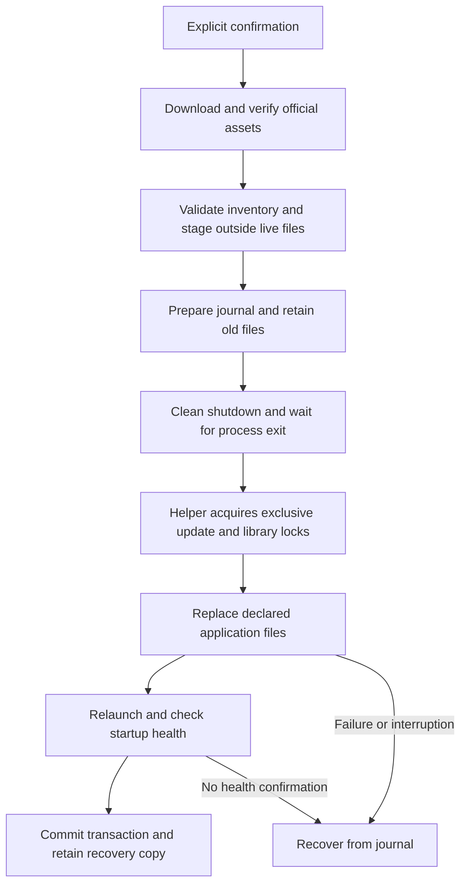

# Update discovery and installation design

## Implemented discovery

Stage 1 performs an explicit user-triggered, unauthenticated HTTPS GET to `https://api.github.com/repos/hectordoesgorug/BookLedger/releases/latest`. It uses GitHub's designated latest stable release, rather than scanning tags or assuming release publication dates are semantic version order. GitHub's [latest-release contract](https://docs.github.com/en/rest/releases/releases#get-the-latest-release) excludes drafts and prereleases; both clients also reject those flags and prerelease tags if returned unexpectedly. No startup timer, provider lookup, telemetry, inventory or configuration write initiates a check.

Desktop uses `services/updates.py`; Android uses `updates/update_service.dart`. Both compare semantic major/minor/patch versions numerically, implement prerelease identifier precedence, ignore build metadata for precedence, and reject malformed versions and numeric identifiers with leading zeroes. Responses are limited to 2 MiB, network operations have five-second timeouts, and errors never imply that the installation is up to date. Desktop reads run in a daemon worker and return through a queue polled on Tk's thread; Flutter networking is asynchronous. Closing the UI discards late results. Notes are plain selectable/scrollable text, never executable HTML.

| State | Meaning |
| --- | --- |
| Up to Date | No newer semantic version than the installed version is designated as the latest stable release |
| Update Available | A newer stable version has the exact expected uploaded platform asset and checksum-manifest asset |
| Unable to Check | Network, timeout, rate-limit/HTTP, oversized, malformed or incomplete-response failure |
| Unsupported Update | Development/unsupported platform, unavailable installed version, or a newer release missing required assets |

An available asset is not an authenticated, validated install. Stage 1 offers **Open Release Page**, not a download/install action. Production Android eligibility is supplied from its existing platform channel using package name, release/debug status and installed version code; debug builds remain unsupported. Desktop eligibility requires a frozen Windows x64 build, distinguishing the fallback `_internal` directory from one-file temporary extraction. This layout heuristic is adequate for discovery only; installation must require explicit packaging/ownership metadata. Source builds can review versions and notes but cannot trigger an updater.

Release-page and asset URLs must match this repository and the parsed version exactly. Ambiguous/duplicate, missing, incomplete or off-repository platform assets are not offered. No metadata-provider key or GitHub token is transmitted. Checks do not change enabled metadata providers or their order. The API may be rate-limited, offline or missing release information; retry is explicit. The current endpoint does not discover a higher Android versionCode with the same semantic versionName, and does not prove certificate continuity. A future installation manifest must carry that information.

## UI integration

The [November 20–21 verification and native results](../TEST_REPORT.md) distinguish earlier test-lifecycle corrections from the later native layout fix. Native source-Windows and isolated debug-Android checks cover light/dark presentation, stable-release discovery, failure recovery and normal navigation. The November 21 desktop UI review also covered the embedded Update page in both themes. Incomplete Tcl/Tk components still cause automated skips, and Flutter Material import deprecations remain an evaluated analysis exception. Frozen Windows builds, production-signed Android upgrades and real installation remain separate acceptance work.

Desktop **Update** is a main navigation page immediately below About and uses `icon-update.svg`. It displays installed and available versions, the update state and explanation, scrollable release notes, and **Check Again** / **Open Release Page** actions. Checks remain asynchronous and stable-release-only. Leaving Update destroys the page and cancels its Tk poll; the worker only writes to that page's private result queue. Returning to Update creates a fresh page and starts a fresh check. No popup Close control, download, or installer is used.

The application banner opens the fixed repository URL through the default browser. It remains the same image size, falls back to the BookLedger text label when the image is unavailable, and supports mouse, Enter, Space, and keyboard focus. The configurable shop logo remains a separate control that opens the configured shop URL. The standalone **Visit GitHub** link has been removed. The canonical version now appears at the far right of the persistent workspace footer, replacing the former status-row update link; the status row remains packed before the expanding workspace so tall Dashboard content cannot hide it. Sidebar button spacing keeps the navigation and left-anchored pairing status visible at the supported `1000×650` minimum. Browser-launch failures appear in the status line. Source/debug checks explicitly say whether a newer stable version exists while retaining Unsupported Update eligibility.

Android Settings places a non-destructive text action immediately below Clear Data, separated by 16 logical pixels. Checking disables that action and shows progress. A dialog displays installed version/code, available version, release notes and the next manual step. Opening the official release page uses the existing external-link channel with an allowlist. Neither the action nor dialog invokes Clear Data, preference writes, pairing removal or pending-photo cleanup. The update explanation warns that session-only pending captures must be transferred before an installation closes the app.

## Release baseline inspected

On November 20, 2026, the public [v1.1.0 release](https://github.com/hectordoesgorug/BookLedger/releases/tag/v1.1.0) exposed:

- `BookLedger-v1.1.0-Windows-x64-Portable.zip`
- `BookLedger-v1.1.0-Windows-x64-Fallback.zip`
- `BookLedger-v1.1.0-Android.apk`
- `SHA256SUMS.txt`

The repository's desktop version is `1.1.0`; mobile is `1.1.0+2` with package `com.bookledger.mobile`. `BookLedger-onefile.spec` bundles application resources in one executable; `BookLedger.spec` uses `_internal` for the fallback runtime. Distribution preparation adds licenses, documentation, a companion APK when supplied, and empty data/backup directories. Startup locates mutable desktop data beside the executable. The release-signing configuration requires external signing properties/keystores and refuses repository-local secrets; none were opened or changed for this work. Existing single-instance enforcement holds an exclusive Windows handle to `.bookledger-instance.lock` for the portable root.

The release metadata and build scripts were inspected; the large published archives/APK were not downloaded, replaced or installed. Live discovery through each implemented client returned installed/available `1.1.0`, 4,542 characters of notes and Unsupported Update in the actual development context. These checks establish discovery connectivity, not safe installation.

## Read-only Windows prototype

`services/update_archive.py` accepts supplied archive bytes, checksum text, expected asset name and package flavor. It checks a unique SHA-256 manifest entry, expected `BookLedger/` or `Fallback/` root, executable presence and fallback runtime presence. It rejects traversal, absolute/drive/UNC-like names, backslash ambiguity, alternate data streams, reserved Windows device names, trailing dots/spaces, control characters, duplicate case-insensitive names, symlinks, encrypted entries, excessive entry counts and excessive uncompressed size. CRC checks read entries without extracting them. Non-empty protected data/configuration/backup entries are rejected; empty package directories do not authorize any destination operation.

The prototype returns inspected relative file names only. It cannot create staging directories, download, terminate a process, acquire an installation lock, select ownership, replace an executable, change a library or relaunch anything. Tests use synthetic ZIPs and disposable fixtures. The checksum text is an input whose authenticity must be established by the future download protocol; hashing alone is not a signature or ownership policy.

## Proposed Windows installation protocol

This section is an implementation proposal, not an active update path.

### Release and helper contract

Future releases must add versioned `update.json` metadata and per-file ownership inventories alongside the existing checksums. Minimum fields are protocol version, minimum helper version, target OS/architecture/flavor, semantic application version, expected executable identity, supported database schema range, archive name/size/hash, and an inventory of file paths, roles, lengths and hashes. The Android section separately declares application ID, versionName, versionCode, ABI support, minimum SDK and signer certificate digests/approved lineage. Unknown protocol/helper versions must be rejected before download or shutdown; old clients can still open the release page. Current release assets lack this contract and therefore cannot be assumed eligible for automatic installation.

Confirmation must identify version, package flavor, data-preservation plan, backup/recovery location, required free space and restart. Use only the verified repository release paths; allow download redirects only to specifically documented GitHub asset hosts over HTTPS, reject arbitrary redirects, never send provider credentials, and enforce time/size limits. Stream into a new private `.partial` file, compute SHA-256 while reading, compare with the exact official `SHA256SUMS.txt` entry and declared byte count, then atomically rename. Failure leaves no installable candidate. Download interruption can be discarded or resumed only after validating release identity/range support and rehashing the entire result.

Checksums hosted beside assets protect against transfer corruption and asset mixups, not a compromised repository/account. A production trust design must additionally address signed manifests/Windows code signatures, trust-key distribution/rotation and signer continuity; a new signer is not silently accepted. The helper itself must have a trusted identity and reside outside the files being replaced. An old process must not execute an unverified helper received from the new archive.

### Paths, ownership and packaging

Create a transaction-specific staging/recovery directory outside live application files, preferably a private sibling on the same volume for rename semantics. Bind the transaction to canonical installation root, original executable path, parent PID plus process identity, package flavor, versions, nonce and verified inventory digests. The helper must reject symlinks/junctions/reparse points, root substitution and paths outside the exact installation/staging roots. Recheck final filesystem identity immediately before changes; do not trust only a previously resolved string path or a reused PID.

An explicit old/new application ownership inventory is required. Only declared files with matching expected identity can be replaced or retired. A newly declared file colliding with an existing unowned file is a conflict, not permission to overwrite it. Removal applies only to obsolete files listed in the old trusted inventory. Never recursively mirror or extract over the portable folder.

- **One-file:** stage the new executable externally; wait until the old executable and PyInstaller extraction child have exited. Retain the old executable in recovery before replacing it. Never treat a temporary `_MEIPASS` directory as the installation root.
- **One-folder:** stage the complete new `_internal` tree and executable together. Preserve the complete old runtime and switch it with the executable under the journal. Mixed old/new runtime files must not be launched. Recheck for locked DLLs; bounded retry followed by recovery is required, not delayed arbitrary deletion at reboot.
- **Always protected:** the entire `data/` and `backups/` trees, portable/fallback `config.json`, pairing credentials, logs, custom assets/photos/posters, the library lock, unknown user files and external signing material. A packaged empty data directory never replaces a live directory.
- **Licenses, documentation and companion files:** update only individually declared application-managed files; preserve user additions. Never automatically install the bundled companion APK. License inventories must stay consistent with the new binary/runtime, including during rollback.

### Shutdown, locking and activation

Before any shutdown, verify directory writability, disk space for staged plus old versions, file ownership and archive identity. Do not request elevation or fall back to writing somewhere else when the installation is unwritable; explain manual relocation/update instead.

Request the existing normal application shutdown path so transactions, mobile reception, logging and resources close. The helper waits for verified process exit and release of the library handle, then holds both an update mutex and the existing library lock while changing files. A racing application launch must fail clearly or wait; releasing the library lock before launch requires a controlled handoff to the new process, not an unrestricted gap. Timeout, active capture/transfer or a process that refuses to close aborts before replacement. Do not force-kill BookLedger to release a library.

Persist and flush a journal before each rename, recording old/new hashes and per-file transitions: `prepared`, `old-retained`, `new-activated`, `launching`, `healthy`, `committed` or `recovering`. Only the helper mutates application files. Revalidate hashes and paths after activation, then start the canonical executable with the original portable root/working-directory semantics and sanitized arguments. A startup handshake with transaction nonce, executable/version identity and bounded timeout confirms that the intended process launched.

If replacement or startup fails before data migration, reverse completed file operations using the retained verified old inventory, check hashes again and offer to relaunch the old version. Keep recovery data until explicit policy permits cleanup; never delete user data during rollback. On power loss, a bootstrap/recovery mechanism outside replaceable files must read the durable journal before normal application startup and complete recovery idempotently. Re-running recovery cannot clobber a file whose identity changed unexpectedly.

Database compatibility is a separate gate. The application currently may migrate SQLite during startup; a binary rollback alone is unsafe after such a migration. Automatic activation must refuse an unsupported schema transition until a separately validated pre-upgrade database/configuration/assets backup and recovery policy exists. Never silently restore a library snapshot or discard user changes merely because the new executable did not report healthy. The future startup health protocol must distinguish pre-migration binary health from a committed data transition.

## Proposed Android installation protocol

Use the official standalone APK, not a Windows archive's incidental APK. Future discovery metadata must supply trusted versionCode, package ID and signer information; semantic tags/release prose are insufficient. Read installed version/code/package and signer from Android PackageManager. A higher versionCode is mandatory even if versionName looks newer; same/lower codes and incompatible ABI/minimum SDK are rejected. See Android's [versionCode contract](https://developer.android.com/guide/topics/manifest/manifest-element#vcode).

After explicit confirmation, stream to app-private staging, enforce limits and verify SHA-256 against the official manifest. Validate APK signature integrity, package `com.bookledger.mobile`, versionCode ordering, expected ABI/platform and the production signing certificate/approved rotation lineage before offering installation. Never rotate signing keys, accept a debug certificate as proof of production continuity, uninstall the app or clear storage to bypass a conflict.

Warn about pending captures before download and again before leaving for installation. Session-only captures can be lost when the app process is stopped; require successful transfer or deliberate user handling before proceeding. Preserve secure pairing, preferences and app data. A checksum or installer confirmation does not prove preservation across a real production upgrade.

Use Android's standard [PackageInstaller](https://developer.android.com/reference/android/content/pm/PackageInstaller) flow or supported content-URI installer intent, with only the required URI grant and normal user approval. If per-source install permission is needed, explain it and let Android present its standard settings/approval flow; do not grant it silently. Returning from permission settings must recheck permission. Cancellation, insufficient storage, signature conflict and installer failure retain the currently installed app and provide a clear result. No silent installation, shell installer, accessibility shortcut or security bypass is permitted.

Version/package/checksum/signature validation, download storage lifecycle, normal permission/installer integration, cancellation recovery, post-upgrade pairing/preferences checks and physical-device acceptance are a separate stage. Stage 1 does not request install permissions, download APKs, call the installer or claim that an upgrade succeeded.

## Acceptance matrix for installation work

Before enabling a real updater, verify one-file and fallback fixtures plus native Windows/production Android cases:

| Case | Required outcome |
| --- | --- |
| Wrong hash, duplicate checksum entry, missing asset or substituted URL | Abort without staging an installable candidate |
| Traversal, absolute/drive paths, symlink/reparse, ADS, reserved/colliding Windows paths, expansion bomb | Reject before writing application files |
| Unknown helper protocol, wrong architecture/package or unowned-file collision | Unsupported update; current installation untouched |
| User data/configuration/photos/posters/backups/licenses/companion additions | Hashes preserved except explicitly declared managed application files |
| Read-only directory, disk full, locked executable/DLL, concurrent launch | Bounded failure and verified recovery; no partial runtime launched |
| Crash/power loss before/after every journal transition | Idempotent recovery to a consistent old or committed new application |
| Relaunch fails, health nonce/PID mismatch or timeout | Verified binary rollback only where data schema permits it |
| Migration required or rollback would use an incompatible schema | Stop for the validated backup/data-recovery protocol, never silently downgrade data |
| Android wrong signer/package, same/lower code, unknown-source permission denied or install canceled | Existing app/data retained; no uninstall/clear-data fallback |
| Production-signed upgrade with pending captures and saved pairing/preferences | Transfer warning honored; actual device verifies data/settings/pairing behavior |

Current automated archive fixtures verify only checksum/path/layout inspection. They do not exercise helper activation, lock handoff, file replacement, signing trust or physical installation. Native UI and installation evidence must be recorded separately from mocked results in the test report.
